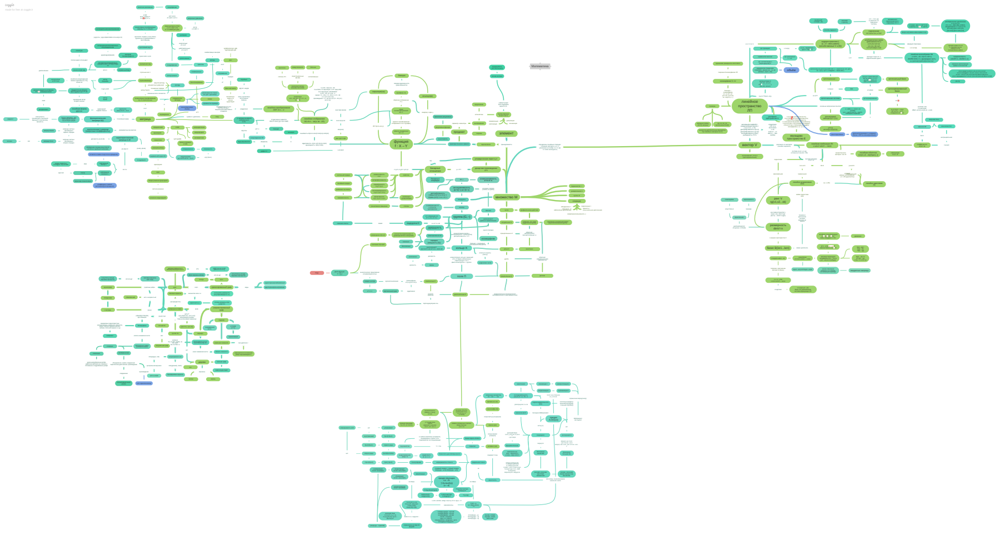

# Ravel

**Десктопный PKM-инструмент с графовой нотацией: типизированные связи, семантическая раскладка, полное ручное управление.**


[](https://github.com/Anastas2817/ravel-pkm/actions/workflows/ci.yml)


> **In English.** Ravel is a desktop PKM tool with a graph notation: relations are typed entities with properties (symmetry, transitivity); the layout is semantic — hierarchy top-down (Sugiyama), ontological bands left-to-right; and control is fully manual — automation only advises (cycle detection, overloaded hubs), the user decides. Local-first: one human-readable, git-friendly JSON file, no cloud. C++23 / Qt 6, MIT. *Full documentation is in Russian.*

База знаний в Ravel — ориентированный граф, построенный вручную и осознанно: каждый узел и каждая связь добавляются пользователем, а система только советует — обнаруживает циклы, выделяет перегруженные хабы, предлагает упорядочить. Связи типизированы и имеют свойства (симметрия, транзитивность), а положение узла несёт смысл: вертикаль кодирует иерархию (общее сверху), горизонталь — онтологические ленты.

*Название — от англ. ravel: «запутывать» и «распутывать» (контроним). Иерархия знаний неоднозначна и строится под задачу; Ravel помогает эту спутанность распутать, не отнимая ручного контроля.*

## Почему Ravel

**Новизна — не в алгоритмах, а в композиции и философии.** Иерархическая раскладка (Сугияма), семантика положения (semantic substrates, conceptual spaces) и типизированные связи сами по себе известны. Новизна Ravel — в их сочетании под принципом «ручное управление; автоматика только советует»: ни один существующий инструмент не даёт одновременно типизированных связей, онтологически осмысленной раскладки и полного ручного контроля над структурой. Подробное позиционирование и обзор связанных работ — [docs/spec.md](docs/spec.md) §2.

**Почему не Obsidian и не Heptabase?** У Obsidian граф — побочный продукт заметок: связи нетипизированы, а силовая раскладка не несёт смысла. У Heptabase есть вложенные холсты, но связи — просто линии, а положение карточек не кодирует онтологию. В Ravel тип связи — сущность со свойствами, а обе оси карты — часть модели знаний.

| Инструмент | Типизированные связи | Семантическая раскладка | Ручное управление | Вложенность карт | Local-first |
|---|---|---|---|---|---|
| **Ravel** | ✅ со свойствами (симметрия, транзитивность) | 🔨 запланировано: иерархия + онтологические ленты | ✅ автоматика только советует | 🗘 фрактальная нотация | ✅ |

Полная таблица сравнения с существующими инструментами и обоснования по каждому — [docs/spec.md](docs/spec.md) §2.1: витрина нормативные детали не дублирует.

(✅ — есть; ◐ — частично; — нет; 🗘 — в перспективах; 🔨 — заявлено, в плане.)

## Оглавление

- [Быстрый старт](#быстрый-старт)
- [Статус проекта](#статус-проекта)
- [Ключевые возможности](#ключевые-возможности)
- [Скриншоты и примеры](#скриншоты-и-примеры-использования)
- [Документация](#документация)
- [Ограничения](#ограничения)
- [Contributing](#contributing)
- [Лицензия](#лицензия)

## Быстрый старт

Требования: CMake ≥ 3.20, компилятор с C++23, Qt 6 (модуль Widgets).

```bash
git clone https://github.com/Anastas2817/ravel-pkm.git
cd ravel-pkm
cmake -B build -DCMAKE_BUILD_TYPE=Release
cmake --build build
./build/bin/ravel
```

Тесты:

```bash
ctest --test-dir build --output-on-failure
```

**Windows / Visual Studio 2022.** Да, проект полностью собирается в MSVC: установите Qt 6 (кит MSVC 2019/2022), затем:

```powershell
cmake -B build -G "Visual Studio 17 2022" -DCMAKE_PREFIX_PATH="C:/Users/*/Qt/6.8.3/msvc2022_64"
cmake --build build --config Release
ctest --test-dir build -C Release --output-on-failure
```

Открыть можно и как `build/ravel-pkm.sln`. GoogleTest и nlohmann/json подтягиваются через FetchContent при первой конфигурации (нужен интернет). `windeployqt` запускается автоматически после сборки — собранный `build/bin/Release/ravel.exe` работает вне IDE без дополнительных шагов. CI (GitHub Actions) гоняет: матрицу `core` — Windows/MSVC 2022 и Ubuntu/GCC в Debug и Release (на GCC — `-Wall -Wextra -Werror`) плюс конфигурацию clang-cl — без Qt, `RAVEL_BUILD_UI=OFF`; job `ui` — отдельная сборка UI-цели на Ubuntu с Qt 6 (проверяется факт компиляции: регрессии сигнатур фасада от правок в ядре); jobs `format` (clang-format `--dry-run --Werror`), `architecture` (скрипт-инвариант 7: `ui/` не включает `graph.hpp` напрямую), `sanitizers` (GCC, ASan+UBSan — ручное индексирование `id − 1` по плотным векторам проверяется на выход за границу на каждом push), `coverage` (gcovr с гейтом по строкам), `tidy` (clang-tidy) и `fuzz` (libFuzzer на `JsonStorage::Load`). Заявленная совместимость с MSVC 2022 и портативность ядра проверяются автоматически.

Если официальный установщик Qt недоступен или работает медленно (например, `download.qt.io` не открывается): Qt можно поставить без установщика и регистрации — скачав готовые бинарники с зеркала (например, `ftp.fau.de/qtproject/online/qtsdkrepository/...`) и распаковав их в выбранный каталог. Для разработки на Widgets достаточно архивов `qtbase`, `qttools`, `qtsvg`, `d3dcompiler`, `opengl32sw` (~70 МБ вместо ~2 ГБ полной установки).

## Статус проекта

Проект на **этапе 3** (Раскладка, недели 6–8); текущий фокус — неделя 6: обнаружение циклов. Этапы 1 (ядро) и 2 (канвас) закрыты; undo/redo подключены к UI досрочно (часть этапа 4). Источник статуса — [docs/roadmap.md](docs/roadmap.md), здесь только сводка (числа тестов и команд сверяйте по коду и roadmap, README их не дублирует).

| Компонент | Статус |
|---|---|
| Модель данных `Graph` | ✅ закрыто (неделя 1: юнит-тесты на инварианты + property-based фаззер: 25 сидов × 150 случайных операций, оракулы полного undo, redo и round-trip) |
| Сериализация JSON | ✅ закрыто (неделя 2: `JsonStorage` Load/Save, round-trip) |
| Канвас (QGraphicsView) | ✅ закрыто (недели 4–5): создание узлов (двойной клик) и связей (Ctrl+drag + диалог типа), перемещение, удаление (Ctrl+D / Delete, rubber-band), стили узлов и связей из онтологии |
| Слой команд (app) | ✅ закрыто: `AnyCommand` (variant + concept), `CommandChronicle` (один вектор + курсор; Execute/Undo/Redo), 6 команд; решения — implementation.md R14, R17–R18 |
| Controller (app) | ✅ Open/Save/SaveAs через JsonStorage (атомарный SaveAs) + мутации через команды; покрыто тестами |
| Раскладка (Сугияма с онтологическими лентами) | 📋 запланировано |
| Обнаружение циклов | 📋 запланировано (текущий фокус) |
| undo/redo (Command) | ✅ работает в UI (досрочно): все жесты канваса — команды, Ctrl+Z / Ctrl+Y |

Отдалённые перспективы (фрактальная вложенность, алиасы, альтернативные иерархии и др.) вынесены в [docs/perspectives.md](docs/perspectives.md) и в план не входят.

## Зависимости

| Зависимость | Назначение | Способ получения |
|---|---|---|
| Qt 6 Widgets | GUI, event loop | устанавливается вручную (официальный установщик, кит MSVC 2022 64-bit) |
| nlohmann/json | сериализация | автоматически, FetchContent |
| GoogleTest | юнит-тесты | автоматически, FetchContent |
| Doxygen | документация API (`doxygen Doxyfile` → `docs/html`) | устанавливается в систему (опц.) |

## Ключевые возможности

- **Типизированные связи** — у каждой связи есть тип (`is_a`, `has_part`, `isomorphic_to`, …) со свойствами (симметрия, транзитивность); цвет и стиль стрелки зависят от типа.
- **Пространственная семантика** (цель проекта, раскладка — в плане) — две оси карты несут смысл: вертикаль — иерархия (общее сверху, частное снизу), горизонталь — онтологические «ленты» (классы узлов); подробнее: [docs/spec.md](docs/spec.md) §5.
- **Иерархическая раскладка** (в плане) — собственная реализация алгоритма Сугияма; минимизация пересечений идёт внутри лент, так что семантика и оптимальность не конфликтуют.
- **Система предлагает — пользователь решает** — циклы (текущий фокус, этап 3), перегруженные хабы (в перспективах): любая автоматика — только рекомендация.

Подробная спецификация — [docs/spec.md](docs/spec.md), архитектура — [docs/architecture.md](docs/architecture.md), план — [docs/roadmap.md](docs/roadmap.md), «проект мечты» — [docs/perspectives.md](docs/perspectives.md).

## Скриншоты и примеры использования

- [x] «До»: реальная карта автора (Coggle) — пример неструктурированного конспекта по матанализу, который Ravel призван заменить. Клик по превью открывает полный PDF:

  [](docs/assets/mm_math.pdf)
- [ ] «После»: та же предметная область в Ravel (30–50 узлов)
- [ ] Скриншот: та же карта после иерархической раскладки
- [ ] Демонстрация: подсказка об обнаруженном цикле

## Документация

Иерархия документов — по строгости и влиянию, стрелка указывает направление свободного влияния:

`metaphors < perspectives < advisors < implementation < architecture/C4 < ADR < spec`

Старшие (строже) влияют на младших свободно. Младшие старших молча не пересматривают: если правка младшего документа затрагивает старший, она фиксируется явной пометкой «на что повлияло» — так ведёт себя [docs/advisors.md](docs/advisors.md). Владельцы: spec — требования и семантика; roadmap — план и статус MVP; architecture — текущая структура и причины; implementation — решения и инварианты; perspectives — будущее (канон перспективных тем: фрактальность, призрачные иерархии, алиасы, PageRank — остальные документы дают только короткую фразу со ссылкой, механизмное следствие для ядра — в ADR-003); advisors — грамматика советов, не фичи; README — витрина со ссылками, без нормативных деталей. Перпендикулярно иерархии живут три документа — [docs/research.md](docs/research.md) (исследовательская рамка), [docs/roadmap.md](docs/roadmap.md) (план по неделям) и README (витрина): они не участвуют в порядке влияния и обновляются по своим правилам.

| Документ | Содержание |
|---|---|
| [docs/roadmap.md](docs/roadmap.md) | план по неделям и статус MVP — единственный источник статуса; README его только сводит |
| [docs/research.md](docs/research.md) | исследовательская рамка: типизированная метрика, взвешенная раскладка, link prediction |
| [docs/metaphors.md](docs/metaphors.md) | метафоры проекта и их границы: образ живёт, только если переводится в контракт одной фразой |
| [docs/perspectives.md](docs/perspectives.md) | отдалённые перспективы (фрактальность, алиасы, …) |
| [docs/advisors.md](docs/advisors.md) | «легенда света»: визуальная грамматика слоя advisors — советы без вердиктов (calm technology) |
| [docs/implementation.md](docs/implementation.md) | эмпирические правила и решения R1–R20: почему код устроен именно так |
| [docs/architecture.md](docs/architecture.md) | слои, обоснования абстракций, инварианты, паттерны |
| [docs/tech_stack.md](docs/tech_stack.md) | обоснование выбора технологий: требования → критерии → C++23 / Qt 6 Widgets / nlohmann/json, инфраструктура «решение → причина», отклонённые альтернативы |
| [docs/assets/c4/](docs/assets/c4/) | C4-диаграммы архитектуры (C1–C4); [docs/c1_scope.md](docs/c1_scope.md) — дополнение к C1: назначение, акторы, сценарии, границы системы |
| [docs/adr/](docs/adr/README.md) | ключевые архитектурные решения (ADR; рекомендованы, не обязательны) |
| [docs/spec.md](docs/spec.md) | концепция, связанные работы, модель данных, семантическая раскладка — самый строгий документ |

Документация API генерируется Doxygen: `doxygen Doxyfile` → `docs/html`.

## Ограничения

Продуктовые ограничения зафиксированы в одном месте — [docs/spec.md](docs/spec.md) §7 «Ограничения»; границы системы и исключения уровня C1 — в [docs/c1_scope.md](docs/c1_scope.md) §5–6. Здесь дублирования нет намеренно.

## Contributing

См. [CONTRIBUTING.md](CONTRIBUTING.md). Кратко: ядро (`core/`) — чистый C++23 без Qt, покрыто юнит-тестами; UI зависит от ядра, но не наоборот.

## Лицензия

MIT
