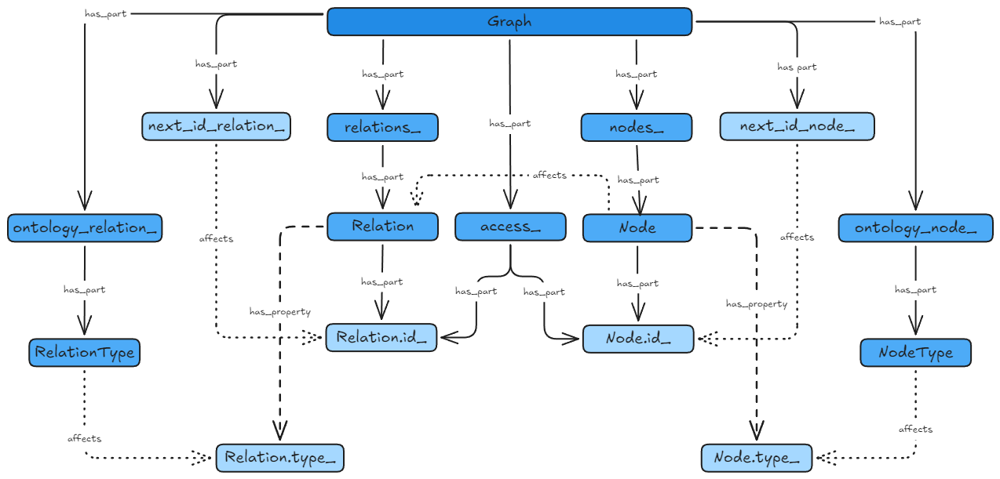

# Техническая спецификация реализации

> Здесь фиксируются выбранные решения по реализации `core/` и рассмотренные альтернативы. Каждое решение — короткая запись «принято / отвергнуто / почему», чтобы развилка не переоткрывалась заново. Документ жёстче, чем [perspectives.md](perspectives.md) (там — развитие за пределами курсовой), и мягче, чем [spec.md](spec.md) (там — требования к продукту; здесь — способы их выполнения). Изменения фиксируются в том же commit flow, что и код.

## R1. Два счётчика идентификаторов: `next_id_node_` и `next_id_relation_`

**Принято.** Отдельный монотонный счётчик для узлов и для рёбер.

**Отвергнутая альтернатива.** Единый счётчик `next_id` на оба вида сущностей (так было написано в spec.md §4.2 первой редакцией).

**Обоснование.**

1. При общем пространстве id коллизии между узлами и рёбрами невозможны, но это не та ошибка, которая реально случается: коллизия возникает при переиспользовании id своего же вида. Раздельные счётчики исключают и её.
2. Реализация проще: «следующий id узла» и «следующий id ребра» читаются и валидируются независимо, правила валидации для каждого счётчика — одно, а не составное условие «больше максимума по объединённому множеству».
3. Размер типа не зависит от числа счётчиков: `uint64_t` в любом случае.

**Последствия для spec.md:** §4.2 абзац про `next_id` переписывается (единое пространство → два счётчика), §4.3 пример JSON меняется на `"next_id_node"` / `"next_id_relation"`. Старое значение `next_id: 6` в примере снимает смысл — в примере узлы 1–3 и рёбра 4–5, новые поля: `next_id_node: 4`, `next_id_relation: 6`.

## R2. Хранение узлов и рёбер: `std::vector` с индексом = id

**Принято.** `std::vector<Node> nodes_` и `std::vector<Relation> relations_`, где **индекс = id − 1** (id начинаются с 1; `emplace_back` кладёт узел id на индекс id − 1 автоматически, смещение живёт только в квадратных скобках индексации — `GetNode`/`GetRelation`). При удалении узла/ребра его слот **не трогается**: данные остаются на месте, живость определяется членством (ADR-002, soft-delete) — наличием записи в `access_` для узлов и двухстадийной проверкой для рёбер (эмпирическое правило 14). Фиктивный объект с id 0 существует только как заполнитель дырок диапазона id при загрузке: `FromSnapshot` предваряет векторы placeholder'ами и раскладывает живые сущности по своим слотам присваиванием.

**Отвергнутая альтернатива (вариант Б).** Пометка `deleted` внутри Node/Relation или обёртка `std::optional` — отдельный флаг сущности. Отвергнута: лишнее поле в каждой записи и вторая логика проверки существования, когда уже есть `access_` как единственный источник истины о «живых» узлах.

**Почему не `std::map<id, T>`.** Индекс = id даёт O(1) доступ и компактное хранение; пространство id неразрывно от начала до максимума, дырки — цена, которую платят только удалённые элементы. Для графов ~10³ узлов это несущественно, и выбор всё равно в пользу простоты индексации.

**Дополнительное обоснование (2026-10-15, внешний разбор): требовательный постоянный потребитель — раскладка.** Аргумент весов разделим честно. Кэш-лояльность на масштабе 10³ — аргумент второго порядка: разница между деревом и плотным вектором в миллисекундах не измерится. Аргумент первого порядка — **алгоритмическая форма самой раскладки**: Сугияма — это проходы. Барицентрические эвристики, сортировка по средним, минимизация пересечений — это подряд идущие свипы по векторам слоёв, индексная арифметика, `layer[i]`, свапы во время прохода. Представление, которое *является* векторами слоёв, встраивается в алгоритм бесплатно; представление, которое является красно-чёрным деревом, требует переписать свипы под обход дерева. То же подтверждает сценарий интерактивной вставки: пользователь кликнул → узел должен немедленно получить локальную позицию — инкрементальные обновления живут на индексированных структурах, а не на итераторах дерева. Итог: плотные векторы выбраны не «оптимизацией ради оптимизации», а правилом 1, применённым к данным, а не к коду, — представление выбрано под самого требовательного известного потребителя (этап 3 roadmap).

**Следствие.** `Node` и `Relation` должны быть assignable (правило пяти): раскладка по слотам при загрузке выполняется присваиванием поверх placeholder'ов (`FromSnapshot`), а не очисткой при удалении — при soft-delete слоты не перезаписываются вообще. `Relation` кроме того копируем — команда удаления сохраняет удалённые рёбра для undo/redo (spec.md §4.4). Конструкторы копирования/перемещения по умолчанию, запрещать их не нужно.

## R3. Инцидентность: `std::map<NodeId, std::vector<RelationId>> access_` 

**Принято.** Узел → вектор id всех инцидентных рёбер; для изолированного узла — пустой вектор. Только живые узлы имеют записи.

**Отвергнутая альтернатива.** `std::unordered_map` — отвергнута не навсегда, а до замера: при ~10³ узлах теоретическое преимущество хэширования над красно-чёрным деревом (в среднем O(1) против O(log n)) может не окупать недетерминизм порядка обхода. `std::map` даёт бесплатный детерминизм: обход окрестности всегда возвращает соседей в одном порядке, что упрощает тесты, отладку и воспроизводимую раскладку.

**Открытая задача → закрыта без бенчмарка (2026-10-12).** Измерение `std::map` vs `std::unordered_map` снято: после ADR-002 порядок итерации по живым узлам — семантическое требование, а не удобство. `ToSnapshot` пишет узлы в порядке обхода `access_`: с map это гарантированное возрастание id, то есть детерминированная сериализация (читаемые git-diff, воспроизводимые тесты, детерминизм раскладки). С unordered_map порядок определялся бы хэш-функцией: файлы плыли бы между сохранениями, а тесты сравнения снапшотов (`EXPECT_EQ` по векторам) пришлось бы сортировать — теряя проверку порядка. Бенчмарк обещал лишь O(log n) → O(1) на операциях, и без того шумных при 10³ узлах, — цена детерминизма неоправданна. Выбор `std::map` зафиксирован принципиально; пункт бенчмарка в perspectives §6 снят.

**Порядок id внутри окрестности — несемантичен; сравнение окрестностей — как мультимножеств (2026-10-14).** Детерминизм выше — про порядок обхода *между узлами* (ключи `access_`), а не про порядок id *внутри* вектора окрестности. Внутренний порядок ничего не значит: инвариант 2 фиксирует только членство; `ToSnapshot` пишет рёбра из `relations_` в ид-порядке, а `FromSnapshot` перестраивает окрестности в порядке снапшота — файл формата не видит внутренний порядок `access_` вообще (round-trip его нормализует); ни один потребитель не читает окрестность позиционно. Критично для undo: удаление стирает id из середины вектора, и восстановить исходные позиции невозможно по построению (они нигде не записаны) — `RestoreRelations` делает `push_back`. Требование от undo совпадения порядка означало бы, что законный возврат состояния не равен исходнику. Поэтому `Graph::operator==` сравнивает каждую окрестность как отсортированные вектора (членство — семантика и сравнивается строго, порядок — игнорируется). Следствие: порядок ид-рёбер в окрестности — производный, неустойчивый к мутациям шум; полагаться на него (в тестах, раскладке) запрещено.

**Смежная альтернатива, отвергнутая.** Хранить в `access_` сразу пары `std::pair<std::vector<RelationId>, std::vector<NodeId>>` (инцидентные рёбра + соседи). Отвергнута: второй вектор дублирует информацию, инвариант «рёбра и соседи согласованы» придётся поддерживать двумя правками вместо одной, а выигрыш — лишний проход по вектору рёбер, чтобы извлечь `to` из `from`.

**Выбор внутри записи: `std::vector<RelationId>`, не `std::set` (2026-09-23).** Аргументы за set — O(log n) поиск/удаление по значению и неинвалидирующий erase — отвергнуты: (1) set при дубликате молча ничего не делает, а дубликат id ребра в окрестности — баг, который должен всплывать в тестах, а не растворяться в структуре; (2) память и локальность — узел дерева ~32 байта на элемент против плотного массива, а итерация по окрестности — горячая операция раскладки. Порядок: vector хранит порядок добавления, set сортировал бы по id — оба детерминированы, на рабочем масштабе разницы нет. Дубликаты страхуем тестом-инвариантом (нет повторов в окрестности), а не структурой. Выбор за прозрачностью vector.

**Альтернатива 2026-10-12, отвергнута: `std::vector<std::vector<RelationId>>` (data-oriented мотив по статье о деревьях на практике).** Идея — то же плотное адресование `id − 1`, что у `nodes_`/`relations_`, плюс кэш-лояльность. Отвергнута по трём причинам, в порядке веса:
1. **Убивает «живость = членство» (ADR-002).** Членство в плотном векторе истинно для всякого выданного id: слот существует всегда, и живой узел без рёбер неотличим от удалённого (оба — пустой вектор). Различие требует параллельной структуры живости (bitset) — то есть возврат к двум хранимым структурам, которые могут рассинхронизироваться, уже без случайного оракула-рассогласования, которое давал зомби-слот у подхода A. Хуже и A, и B.
2. **`vector<vector>` — не flat.** Это массив заголовков (~24 байта), каждый указывает на отдельный блок кучи: первый уровень последовательный, второй — тот же pointer chasing с промахами кэша, что у map, плюс аллокация/освобождение внутреннего вектора на delete/restore. Настоящая плоская форма разреженного индекса — CSR (offsets + один плоский массив), но CSR родом из статических графов: вставка/удаление из середины плоского массива — O(deg) со сдвигом, а undo/redo переключает членство постоянно. Физика data-oriented design не переносится напрямую: access_ — разреженный производный индекс с переменной длиной записи, а не первичные данные.
3. **Масштаб.** Аргументы про prefetcher и 50–100 нс промаха решают на горячих циклах по 10⁵–10⁶ элементов. Горячий цикл раскладки итерирует живых узлов: при N=10³ это сотни записей, O(log N) map на горячем кэше — шум; а разреженная структура для «итерировать живых» трогает память *меньше* плотной (не проходит по слотам трупов). Детерминизм итерации в порядке id сохраняется в обоих вариантах — из аргументов «за» он не решающий.

**Защитная формулировка.** `nodes_`/`relations_` — плоское хранение первичных данных: прямое адресование по `id − 1` без pointer chasing, последовательные обходы дружественны prefetcher'у, сознательная цена O(max_id) памяти (при лимите 10⁶ — десятки МБ в худшем случае, при реальных 10³ — ничтожно). `access_` — разреженный индекс к ним; data-oriented логика применена к каждой структуре по её природе: плоские массивы — данным, разреженный упорядоченный ассоциативный контейнер — индексу с переменной длиной записи.

**Addendum (2026-10-15, внешний разбор): направленная аджесенси `out_`/`in_` — кандидат, не решение.** Замечание: общий список инцидентных рёбер заставляет алгоритмы, ходящие по *исходящим* рёбрам (Сугияма, DFS по циклам, PageRank), платить лукап `GetRelation(rid).from()` на каждом шаге — направление можно зафиксировать структурно. Решение отложено по правилу 1: потребитель появится на этапе 3 (Algorithms/Layout), до этого `out_`/`in_` — индекс без читателя плюс двойное обслуживание окрестностей при каждой мутации (Delete/Restore каскадом правит два списка вместо одного). Формула: `out_`/`in_` вводятся вместе с первым алгоритмом-потребителем; цена ввода — двойная правка окрестностей, цена отказа — лукап направления в горячем цикле. Развилка зафиксирована, чтобы не переоткрывалась.

**Addendum (2026-10-15): `GetNeighbors` возвращает `std::set` по значению — аллокация на каждый вызов.** Для DFS/PageRank по 10³ узлам некритично, но Layout/Algorithms, читающие граф целиком свипами, вероятно захотят ForEach-стиль (как `ForEachLiveNode`): колбэк по соседям без промежуточного контейнера. Отложено по правилу 1 — вводится с первым потребителем на этапе 3; развилка зафиксирована заранее, чтобы итерация по соседям не выросла из `GetNeighbors` по привычке. До тех пор `GetNeighbors` — удобство для разовых запросов, не для горячих обходов.

## R4. Типы сущностей: словари с строковыми ключами

**Принято.** `std::unordered_map<std::string, NodeType> ontology_node_` и `std::unordered_map<std::string, RelationType> ontology_relation_`. Node/Relation ссылаются на тип по имени (строка в JSON, spec.md §4.3).

**Отвергнутая альтернатива.** `enum class` для фиксированного набора типов (`is_a`, `has_part`, …). Отвергнута: словарь типов расширяем пользователем через JSON (spec.md §4.5), enum требует перекомпиляции на каждый новый тип. Enum остаётся удобен только как набор констант-предложений по умолчанию.

**Обоснование строкового ключа.** Имя типа — пользовательский идентификатор; он же ключ в JSON, его же видит пользователь в диалогах. Прямое соответствие «строка в файле ↔ строка в памяти» убирает слой преобразований и источник рассинхронизации.

**Рост заголовка и план выделения Ontology (2026-10-17).** `graph.hpp` агрегирует всё (типы, DTO, концепты, снимок, Graph, инлайн-валидация) и растёт с каждым решением. Момент выделения словарей в отдельный объект `Ontology` наступает ориентировочно при ~500 строках заголовка, когда любая правка начинает трогать всех (та же критерия, по которой выделится GraphSource — из двух реализаций, а не заранее). Решение на будущее: при выделении словари становятся `std::map`, не `unordered_map` — консистентный детерминированный порядок итерации с самого начала жизни отдельного объекта, чтобы вопрос unordered/map вообще не возникал (прецедент доступ_: членство + порядок в одной структуре, R3).

## R5. Описание узла: `std::string description`

**Принято.** Полное описание хранится строкой в Node. Размер типа в памяти не зависит от длины текста (SSO покрывает короткие описания, длинные — куча).

**Отвергнутая альтернатива.** Отложенное чтение описания из файла/внешнего хранилища по запросу. Отвергнута: описание нужно при каждом выборе узла (панель деталей), выигрыш в памяти на ~10³ узлах ничтожен, а цена — второй слой хранения и кода. Оптимизацию рассматривать, только если профилирование покажет проблему.

## R6. Позиция узла: в Node, необязательная

**Принято.** Ручная позиция — поле `Node` (не `NodeType`: позиция относится к экземпляру, а не к типу, spec.md §4.2). Наличие позиции опционально: узел без неё подчиняется раскладке.

**Закрыто (2026-09-21).** `std::optional<std::pair<double, double>>`: `std::nullopt` — позиция не задана, узел подчиняется раскладке; значение — ручное переопределение (spec §5.5). Отвергнутая альтернатива — сигнальная пара значений (NaN/−1): у неё нет типобезопасной проверки «задано ли», легко получить молчаливую ошибку. Опциональность не попадает в JSON: отсутствие поля `hand_position` и есть «не задано» (round-trip, spec §4.3).

**Решение о выносе (2026-10-17): `hand_position` покидает `Node`.** Обоснование: позиция по природе вычислима — большинство узлов получают её от раскладки, а не от руки пользователя; «вычислимое в модели не хранится». Вычисленное хранение прижимается требовательным потребителем (раскладка, свипы по слоям) и будущим потребителем из призрачных иерархий (perspectives §2: per-view позиции, кэш раскладки на вид). Форма: side-map в Graph (`std::unordered_map<NodeId, Point>`), `Node` остаётся идентичностью и содержанием; заодно `std::pair<double, double>` заменяется на `struct Point { double x, y; }`. Следствия: MoveNode и валидация nan/inf переезжают к side-map; снапшот получает отдельную секцию позиций (форма — при реализации); undo позиции работает через летопись, не трогая идентичность узла (комментарий про exact == для double переезжает к Point). Расхождение с исходным R6 осознанно: позиция перестаёт быть частью идентичности узла — это и есть суть выноса.

**Подвопросы закрыты (2026-10-17, после оспаривания требования сортировки).** (1) Персистентность: секция позиций сохраняется в файл — ручная расстановка это данные пользователя, терять её молча недопустимо (отвергнута альтернатива «чистый runtime-кэш с пересчётом раскладки на загрузке»). (2) Зомби-записи позиций (позиция узла, удалённого в течение сессии) терпятся в side-map до конца сессии — по той же логике, что трупы в `nodes_`/`relations_` (ADR-002, компактификация на границе сессии) — но в снапшот не попадают: сериализуются позиции только живых узлов, мусор в git-friendly файл не несём.

## R7. Правила валидации счётчиков при загрузке

Загрузчик (слой `storage/`) проверяет и при нарушении отклоняет файл явной ошибкой:

1. `next_id_node_` строго больше максимального id узлов (для пустого множества узлов — не меньше стартового значения).
2. `next_id_relation_` строго больше максимального id рёбер (аналогично).
3. Молчаливая починка (автоматическое повышение счётчика) запрещена: см. обоснование в spec.md §4.2 и R1.

Это защита на границе слоя: недоверенный внешний файл валидируется один раз при входе, дальше внутри `Graph` инварианты поддерживаются конструкцией.

## R8. Имя типа — только ключ словаря; записи словаря неизменяемы

**Принято.** У `NodeType`/`RelationType` нет поля `name_`: ключ `unordered_map` — единственный источник имени типа. Классы неизменяемы после создания (конструктор со всеми параметрами, нет сеттеров); «переименование» = создание нового типа (spec.md §4.5 фиксирует неизменяемость как продуктовое решение; здесь — её техническое следствие).

**Отвергнутая альтернатива.** Хранить `name_` внутри записи вдобавок к ключу. Отвергнута как денормализация: одна информация в двух местах — это новый инвариант «ключ == name_», который ничто не проверяет, и гарантированная когда-нибудь рассинхронизация. При обходе словаря ключ доступен рядом со значением (structured bindings, C++17).

**Отвергнутая альтернатива.** Публичные поля-структуры ради «простоты заполнения». Отвергнута: без конструктора невозможно выразить «тип существует только полностью заданным» — то же правило «тип отстаивает своё», что и отсутствие `Node()` (см. эмпирические правила).

## R9. Ключи файлового формата: `relations` и `node_types` (синхронизация 2026-09-25)

**Принято.** Секция рёбер в файле называется `relations`, секция словаря типов узлов — `node_types` (spec.md §4.3, пример JSON).

**Отвергнутая альтернатива.** Ключ `edges` (так было в первой редакции примера §4.3) — отвергнут как рассинхрон с кодом и документацией: класс `Relation`, инварианты Graph, тексты spec и implementation повсюду говорят «relation/связь»; единственное место со словом «edges» — пример JSON, то есть формат файла расходился бы с моделью, которую сериализует. Файл — тоже интерфейс: пользователь правит его руками (§4.5), и имена ключей должны совпадать с терминами диалогов и документации.

**Синхронизировано заодно.** В пример §4.3 добавлена секция `node_types`: в коде словарь `ontology_node_` существует с недели 1, инвариант 5 («тип каждого узла содержится в словаре») требует его наличия в файле, а в примере секция отсутствовала. В §4.2 добавлен пункт «Тип узла» (свойства `color`, `shape`, `frame_color` — по полям `NodeType`).

## R10. JsonStorage: контракт Load/Save (2026-09-26)

**Принято.**

1. `Load` возвращает `Graph` по значению. Полученный Graph гарантированно валиден: недопустимы полуинициализированные состояния (принцип «тип отстаивает своё»), при исключении в середине загрузки частичный Graph уничтожается раскруткой стека. Бонус: откат к предыдущей версии файла (как в Coggle) достаётся бесплатно — старый файл и есть старая версия.
2. Validate-then-apply: два прохода. Сначала полная валидация JSON вне Graph (`format_version` → счётчики против max id своего вида → словари типов → тип каждого узла/ребра в соответствующем словаре), затем построение Graph через публичный API (`AddNodeType`/`AddRelationType`/`AddNode`/`AddRelation`). Storage не имеет доступа к приватным членам Graph — инварианты поддерживает только Graph (см. правило 11).
3. Валидация формата цвета (`#RRGGBB`) — на входе в Graph (`AddNodeType`/`AddRelationType`), не в Save: Graph недопустимо долго жить с некорректными данными, чтобы ошибка всплыла в другом слое. Save доверяет инвариантам Graph и пишет то, что есть.
4. Работа с потоками (`std::istream&` / `std::ostream&`), не с путями файлов: round-trip тесты не трогают диск (источник — `std::stringstream`), открытие файлов — забота слоя `app`. Выбор потоков перед строкой (2026-10-03): поток — самый абстрактный источник байтов, не привязанный к конкретному контейнеру; композируется с будущими источниками (gzip, сокет для §11 perspectives) без промежуточной материализации. DOM-парсинг nlohmann всё равно держит документ в памяти, поэтому поток здесь не оптимизация, а зафиксированное направление зависимости: storage получает байты, но не владеет их происхождением. Строка отвергнута: весь выигрыш — пара строк кода (`dump()`/`parse`), испаряющийся при первом не-файловом источнике.

**Отвергнутые альтернативы.**

- `Load(path_to_graph_by_reference)`: полуинициализированный Graph снаружи, лишение Graph контроля над своими инвариантами.
- Интерфейс `IStorage` сейчас: преждевременная структура — вторая реализация не запланирована, mock не нужен (тесты ходят в JsonStorage напрямую). Интерфейс выделится при появлении второго хранилища, его контракт будет известен из двух реальных классов, а не угадан (см. эмпирическое правило 1). Развилка фиксируется, чтобы не переоткрывалась.
- Валидация цвета в Save: откладывает диагностику от места порождения ошибки (принцип «валидация на границе слоя» — а публичный API Graph тоже граница).

**Дополнено.** Пункт 2 изменён: построение через публичный API заменено на `GraphSnapshot` + проверяемую фабрику `Graph::FromSnapshot(...)` — см. R11. Отвергнутые там friend и публичная фабрика без снимка здесь не дублируются.

**Дополнено (2026-10-01).** Пункт 3 уточнён: валидация `#RRGGBB` перенесена из `AddNodeType`/`AddRelationType` в конструкторы `NodeType`/`RelationType` (`isValidHexColor`, `inline` в заголовке). Конструкторская точка сильнее границы Graph: тип существует только валидным (правило «тип отстаивает своё»), и валидация покрывает любой путь создания типа, а не только путь через Graph. Граница Graph остаётся второй линией обороны (дубли имён в словарях). Отвергнутая альтернатива «валидация в Save» закрыта ранее и остаётся закрытой.

**`format_version` не входит в `GraphSnapshot` (2026-10-04).** Версия — свойство файла, то есть слоя storage; снимок по R11 — «нейтральные данные без формата», и у данных в памяти версии нет (они ещё никуда не сериализованы). Save всегда пишет текущую версию (2); Load валидирует и отбрасывает. Следствие: поддержка старой версии формата при её появлении — преобразование внутри storage в актуальный снимок, core не трогается. Отвергнутая альтернатива: поле в снимке — протащило бы знание о формате в core и создало бы состояние «снимок версии 2», о котором непонятно, кто обязан помнить.

## R11. Загрузка: `GraphSnapshot` + `Graph::FromSnapshot` (2026-09-29, по рекомендации преподавателя)

**Принято.** Трёхсторонняя схема: JsonStorage разбирает JSON ↔ `GraphSnapshot`; Graph валидирует снимок и сам восстанавливает внутренние структуры. Снимок — нейтральные данные без формата: словари типов, живые узлы и рёбра с их исходными id, счётчики.

**Почему публичная фабрика здесь не опасна.** Возражение против публичной фабрики было «любой сможет создать Graph с поддельными счётчиками». Рекомендация преподавателя разделяет две вещи: публичность *метода* и отсутствие *валидации*. `FromSnapshot` обязана отклонять неверные данные явно (счётчики ≤ max id своего вида, типы вне словарей, концы связей на несуществующие узлы — инварианты 1, 4, 5). Метода вставки произвольного id в *существующий* граф при этом не появляется — монополия Graph на выдачу id сохраняется.

**Обязательная деталь восстановления.** Файл хранит только живые узлы; при живых id 1, 2, 5 и выданных до 8 счётчик обязан вернуться равным 9 (инвариант 1). `FromSnapshot` восстанавливает слоты хранения (R2): живые записи — на свои индексы (id − 1), удалённые слоты до `next_id − 1` — фиктивными объектами (id 0). Без этого первый же `emplace_back` нарушил бы соответствие «индекс = id − 1». Следствие для формата: дырки в файле не хранятся и не передаются — они восстанавливаются графом из семантики счётчика.

**Нормализация пустого снимка и проверка уникальности (2026-10-01).** Счётчики, равные 0, отвергаются: минимальный легальный снимок — `next_id_node = next_id_relation = 1` с пустыми векторами (он равен стартовому состоянию `Graph()`). Проверка «счётчик > max id» (инвариант 1) применяется только к непустым спискам: максимум существует лишь тогда, когда сущности есть; для пустого списка допустим любой счётчик ≥ 1 (все сущности удалены). Уникальность id проверяется слиянием проверки и вставки в `std::unordered_set`: `!set.insert(id).second` бросает при дубле — одно обращение к таблице вместо пары `count` + `insert`; направление флага: `true` — вставил (новый), `false` — уже был (дубль).

**Порядок сериализации (2026-10-02).** `ToSnapshot` кладёт живые узлы и рёбра в снимок по возрастанию id (обход слотов). Причина — детерминизм побайтового round-trip (тест `StorageLoadSave.RoundTrip` сравнивает строки), а не требование формата: загрузчик принимает любой порядок векторов снимка. Следствие: `FromSnapshot` не должна полагаться на порядок входных векторов — это свойство одной стороны преобразования, а не контракта обеих.

**Следствия.**
- Геттеры словарей через `const&` — допустимы (подтверждено): запрет на изменение сохранён; раскрытие выбора контейнера и срок жизни ссылок — принятая цена.
- Небольшое поведение у Node/Relation оправдано: основные инварианты относятся к графу целиком.
- `GraphSource` отложен; второго полный формат будет строить тот же снимок.
- Ответственность Graph признана связной (поддержка корректного состояния карты); словари типов могут позднее стать отдельным объектом, сериализация, история команд и алгоритмы развиваются за пределами Graph.

**Отвергнутые альтернативы (фиксируются закрытыми).** friend + приватная фабрика (обсуждено в R10-дополнении); `GraphSource` сейчас; построение через публичный API с перенумерацией (ломает идентичность, §4.2 spec).

**Геттеры словарей: рассмотрение итераторной альтернативы (2026-09-30).** Помимо `const&` рассмотрены: пара `begin()/end()` — отвергнута (тот же тип контейнера в сигнатуре, сокрытия нет, читаемость хуже range-for); callback-итерация `ForEachNodeType(fn)` — единственный вариант, реально скрывающий контейнер, отвергнута (плохо компонуется; преждевременна при одном потребителе, правило 1); кастомный итератор-фасад — отвергнут (обёртка с семантикой контейнера без реального потребителя). Сокрытие контейнера откладывается до выделения словарей в отдельный объект: фасад появится вместе с потребителем. Контракт срока жизни ссылок фиксируется Doxygen-комментарием у геттера («lifetime bound to *this; do not store beyond the Graph's lifetime»); каналы — документация и ревью: запрет кэшировать `const&` из геттера в поле класса между мутирующими вызовами. Тестами висячую ссылку не поймать (это UB), поэтому канал только документационный.

## R12. Отклонённый Observer: Graph никого не оповещает (2026-10-09)

**Рассмотрено.** Контракт `IGraphObserver` в Core: Graph эмитит события мутаций, UI подписывается и перерисовывает. Скелет (интерфейс, контроллер с пробросом `Subscribe`, `AddNodeCmd`, `CanvasView`) был написан и удалён до наполнения тел.

**Почему отклонено.**
- Все мутации рождаются в UI и синхронно проходят через App: инициатор запроса тут же получает ответ (id, позиции, ошибки). Пуш-оповещения нужны только при внешних мутаторах (коллаборация, фоновые процессы, плагины) — их нет ни в MVP, ни в перспективах.
- App — воронка команд и без наблюдения знает о каждой мутации: dirty-flag, автосейв, undo/redo наблюдателя не требуют.
- Layout/Algorithms — pull-клиенты (`const Graph&` на входе), события «узел добавлен» им бесполезны.
- Поиск — запрос (линейный проход по титулам), а не подписка.

**Формула для будущего.** Появится второй источник мутаций — оповещение вводится на границе App, не внутри Graph. Согласуется с правилом 21 (абстракция поведения угадывается, данные — нет) и рекомендацией преподавателя (алгоритмы, сериализация, история команд — за пределами Graph).

**Открытые следствия (принято осознанно).** Обратный поток — синхронные ответы, UI обновляет сцену по результату своего же запроса; если когда-нибудь мутация станет долгой, синхронность пересматривается вместе с появлением очереди, а не раньше.

## R13. Стоимость операций: A (зомби) против B (soft-delete) — количественное сравнение (2026-10-12)

Обозначения: N узлов, R рёбер, k сущностей в команде, deg — степень узла. Решение — B (ADR-002); разбор нужен для защиты: выбор осознан, с перечнем отданного. При лимите 10³ все различия — микросекунды и килобайты, пользователь их не почувствует; ценность раздела — показать понимание компромисса.

**Execute.** Доминирует обслуживание `access_` (map O(log N), vector-erase O(deg) у соседей) — идентично в обоих. Остаток: A дополнительно зануляет слот O(1); B — нет. Выигрыш B символический. Асимптотически ничья, практически B ≤ A.

**Undo / redo — здесь разница принципиальная.** A платит копированием данных на каждое применение команды; B — только переключением членства:

| Команда | Undo в A | Undo в B | Redo в A | Redo в B |
| --- | --- | --- | --- | --- |
| Add(k) | удалить: занулить слоты + чистка `access_` | стереть членство O(k·deg·log N) | восстановить копии DTO — строки, аллокации | вернуть членство O(k·deg·log N) |
| Delete(k) | восстановить копии DTO — строки, аллокации | вернуть членство + id каскадных рёбер из стека | повторить удаление | повторить удаление |
| Move | O(1) оба | O(1) оба | O(1) оба | O(1) оба |

Ключевые пункты: B строго дешевле на undo-delete и redo-add — ноль копирований строк; undo и redo в B симметричны по цене (одни и те же map/vector-операции над одним хранимым списком id), асимметрии «undo дороже redo» нет. В A симметрия тоже есть, но дорогая: обе стороны мементо-копируют DTO.

**Память.** Модель: A компактна (слоты освобождаются немедленно), B растёт монотонно в сессии (сброс только через save/load). Стек команд: A тяжёлый — полные DTO плюс дублирование (Add-команда хранит копию живого объекта: данные в двух экземплярах); B лёгкий — id и список каскадных рёбер, дублирования нет никогда. Итог: сумма «модель + стек» сопоставима — разница в том, **где лежит история** (у A — в стеке с дублями, у B — в модели без дублей). Копия графа целиком (ветвление, сравнение): у A трупы пустые и дешёвые, у B копируются вместе с валидными строками трупов.

**Сценарии.** B выигрывает: массовые undo/redo (откат удаления поддерева), длинная интерактивная сессия (стек килобайты id), частые Add (данные в одном экземпляре), фрактальность (undo вложенной ветки — рекурсивное переключение членства, а не копия снапшота поддерева). A выигрывает: копия графа целиком, массовая зачистка базы без откатов, сериализация (O(N+R) против O(R·deg), на звёздном графе до O(R·N)), гипотетический ограниченный стек undo (у A вытеснение команды освобождает данные, у B требует компактификации модели).

## R14. Слой команд (app): variant + concept, redo через `Restore*` (2026-10-15)

**Принято.** Команды — маленькие значения с членами `Do`/`Undo` (смешение данных и действия); гетерогенное хранение — `std::variant` (`AnyCommand`), концепт `Command` — явный контракт, закреплённый `static_assert` на все альтернативы. Наследование (`ICommand` + `unique_ptr`) отклонено: набор команд закрыт, variant даёт exhaustive-обработку и value semantics без аллокаций; наследование оправдано для открытого мира (плагинные команды), которого нет. Разделение «чистый DTO + handler» отклонено по правилу 1 — переоценивается на границе сериализации летописи в файл (тот же критерий, что у GraphSnapshot) или при зависимостях `Do` шире `Graph&` (Storage savepoints).

**Redo Add-команд = `Restore*` по `obtained_id`.** Дивиденд ADR-002: повторное выполнение восстанавливает ту же сущность с тем же id, бит-в-бит, без копирования данных. `Do` ветвится на `obtained_id != 0`; двойной `Do` без `Undo` — нарушение контракта со стеком, ловится debug-assert'ами `Restore*`.

**`CommandResult = std::expected<void, CommandError>`.** Enum резервирован под границу Controller'а (единственную точку перевода исключений Graph в результат для UI); команды исключения пока пропускают, enum никем не производится — зафиксировано, чтобы `.value()`-подобные полуиспользования не выглядели недоделкой.

**Политика позиций.** `MoveNodeCmd` требует существующей позиции (`from` — не `optional`; `.value()` на результате `MoveNode` кодирует предусловие броском). Первое (вычисленное) позиционирование раскладкой — инициализация, а не действие пользователя: летопись его минует. Согласуется с комментарием у `Node::operator==` (позиция раскладки — вычисленное значение, не хранимое). API снятия позиции в ядре не вводится до появления потребителя (правило 1).

**Почему раскладка не мутирует Graph напрямую, хотя живёт в core.** Техническая возможность (`Layout` и `Graph` — соседи по слою, API публичный) ≠ санкция. Инвариант 7 (все мутации — через команды) существует ради целостности летописи: undo-стек воспроизводит состояние строго как последовательность команд, и любая обходная мутация делает replay ложным (позиция, о которой ни одна команда не знает, молча теряется при undo/redo). Поток: `Layout` читает Graph и вычисляет позиции (чистая функция структуры → геометрии), запись выполняет App командами. Так держатся однонаправленность (C2: App — единственный источник мутаций) и односторонняя зависимость Layout → Graph: прямая мутация превратила бы её в двустороннюю и потащила бы знание об undo внутрь алгоритма.

**Addendum (2026-10-16): хранение летописи — один вектор + курсор, не два стека.** Вместо пары векторов `undo_`/`redo_` с миграцией элементов между ними — единый `std::vector<AnyCommand> history_` и курсор `cursor_` (число исполненных команд; единственный инвариант: `0 ≤ cursor_ ≤ history_.size()`). `Execute`: стереть хвост `[cursor_, end)`, `push_back`, `++cursor_`. `Undo`: `--cursor_`, `Undo(history_[cursor_])`. `Redo`: `Do(history_[cursor_])`, `++cursor_`. Метафорически точнее: одна летопись с закладкой, а не две хроники с переливанием; исчезает миграция и её двойная дисциплина. Стоимость erase хвоста — O(оставшееся), амортизированно каждая команда стирается не более одного раза. `std::stack` не рассматривался всерьёз: обёртка `CommandHistory` владеет парой контейнеров и логикой больше контейнерной (коалесцинг, очистка redo, групповой undo, будущий лимит глубины с выталкиванием с начала — у стека доступа к началу нет, логирование истории), поэтому члены-векторы выбраны сразу.

**Addendum (2026-10-17): `DeleteNodes` возвращает вектор каскадно удалённых рёбер.** Закрывает реальную дыру слоя команд: `DeleteNodesCmd::deleted_relations` сейчас нечем заполнить, и Undo удаления узлов восстанавливает узлы без рёбер. Контракт возврата: только жившие до вызова, дедупликация; порядок не специфицирован (текущая реализация возвращает по возрастанию id — `std::set` даёт это бесплатно; отдельное требование сортировки не вводилось: `SessionEqual` сравнивает окрестности order-insensitively, `relations_` soft-delete не перестраивает, сериализация идёт по `relations_` — потребителя порядка нет, см. правило 31). Согласуется с прецедентом `MoveNode` (возвращает прежнее состояние) и убирает дублирование каскадной семантики в App. Ограничение глубины летописи (когда появится потребитель): логический лимит через `start_`-закладку — физически команды (id) ничего не стоят, хроника хранится целиком, выталкивание не освобождает трупы (soft-delete), компактификация — на границе сессии (save/load).

## Инварианты Graph (сводно)

> **Протокол ≠ инвариант (2026-10-17).** Инвариант — истина о домене, её поддерживает модель (7 инвариантов ниже: валидация в API, тест-инварианты). Протоколы и предусловия вызывающей стороны (LIFO-дисциплина летописи, «не мутировать во время `ForEachLive*`», порядок Restore «сначала узлы, потом рёбра») — легитимны, если коротки, документированы и покрыты debug-assert'ами; App, исполняющий дисциплину Restore, — не «утекшая в App сложность», а штатный протокол. Инвариант 7 (все мутации — через команды) защищён **конвенцией**, не техникой: API Graph публичен, UI линкуется с core, прямая мутация обходом App компилируется. Канал контроля — ревью; для одного автора это принято осознанно (этап 2). Технические барьеры (friend, capability-токен, pImpl-фасад) отклонены как структура без выигрыша; пересматривается при появлении второго разработчика или первого инцидента.

1. Id не переиспользуются; `next_id_node_` / `next_id_relation_` строго больше всех существующих id своего вида.
2. Для любого ребра r и любого узла x: r лежит в `access_[x]` тогда и только тогда, когда x — это from или to ребра r.
3. `access_` содержит записи ровно для живых узлов: каждый живый узел имеет запись (возможно, с пустым вектором), ни один удалённый — нет. Каждая запись, кроме того, содержит ровно живые рёбра: в окрестности узла нет ни одного id мёртвого ребра — `DeleteRelations` вычёркивает ребро из окрестностей обоих концов, и на этом держится каскад `DeleteNodes` без единой проверки («by the invariant, only live relations are listed there»). Симметрично инварианту 2 это «только если» в обе стороны: окрестность ⇔ живость ∧ инцидентность.
4. Рёбра ссылаются только на существующие узлы: from и to каждого живого ребра — живые узлы.
5. Тип каждого узла и каждого ребра содержится в соответствующем словаре онтологии.
6. Тип связи отстаивает своё: фиксированные свойства (симметрия, транзитивность) задаются при создании типа и не меняются.
7. Все мутации графа выполняются через команды: единственная точка изменения состояния (с этапа 2 действия канваса оформляются командами без стеков; стеки undo/redo — этап 4).

> **Контракт удаления: идемпотентность (2026-10-11; механика обновлена под soft-delete 2026-10-13).** `DeleteNodes`/`DeleteRelations` идемпотентны относительно дубликатов в аргументе: повтор id в списке не бросает исключение и не портит состояние. Это осознанный контракт, а не случайность реализации. Обоснование выбора «документировать, а не запрещать» — правило 13 в зеркальном применении: дубликат в списке на удаление — не баг данных, а вырожденный случай корректного запроса («удалить 5 дважды» = «удалить 5»). В отличие от окрестности (R3), где дубликат — нарушение инварианта 2 и должен всплывать. Механика контракта сменилась вместе с семантикой удаления: при зомби-подходе держала «повторное стирание уже пустого слота безвредно» (вторая итерация читала очищенный слот: концы = 0, `HasNode(0)` ложен, `access_` не трогается); при soft-delete (ADR-002) дубликаты сливаются в фазе validate (`std::set` внутри, не в сигнатуре — иначе контракт исполняла бы конверсия типа на границе и был бы нетестируем), apply работает с гарантированно уникальным множеством без единой проверки. Граница контракта прежняя: id, мёртвый **до** вызова, — ошибка (`std::invalid_argument`); повтор id **внутри** одного вызова — допустим и игнорируется. Гарантия закреплена тестами `GraphDeleteNodes.DuplicateIdsInArgument` и `GraphDeleteRelations.DuplicateIdsInArgument` противопоставлен негативным тестам на отсутствующие id. Обобщено в эмпирическом правиле 27.

## Диаграмма классов ядра

Обозначения рёбер — в разделе «Условные обозначения диаграмм классов» ниже.

> **Заметка о собственном корме (dogfooding).** При рисовании этой схемы автору не хватило описаний **у узлов**: неочевидно, что такое `relations_` (это `std::vector<Relation>`), `ontology_node_` (`std::unordered_map<std::string, NodeType>`), `access_` (`std::map<NodeId, std::vector<RelationId>>`) — и **у связей**: ребро `has_part` из `Graph` в `Node`/`Relation` читается неоднозначно без пояснения, что владение означает именно жизненный цикл, а не «ссылка на». Это та самая боль, для которой в Ravel заведены описания узлов и связей (spec.md §4.2): схема — живое обоснование фичи, а не выдуманный use case.

## Эмпирические правила

Правила, выученные на ошибках — общие для всего проекта, не привязаны к конкретному решению.

1. **Структура меняется по запросу алгоритма, не забегая вперёд.** Не объявляются конструкторы, спец-члены, поля и флаги «на вырост»: появился запрос (undo требует копирования `Relation`, очистка слота — move-assign у `Node`) — структура меняется под него. Преждевременные объявления дороже отсутствующих: они создают противоречия, которые потом приходится разгребать (см. первую редакцию `graph.hpp`).
2. **Правило пяти — только при ручном владении ресурсом.** Сырые указатели, дескрипторы, HANDLE — объявляем всё пять и думаем. Нет ресурса — правило нуля: спец-члены не объявляются вовсе, компилятор генерирует корректные. `= delete` по привычке — такой же дефект, как и отсутствие `= delete` там, где он нужен.
3. **Порядок объявлений в заголовке повторяет зависимости.** Кем пользуются — объявляется выше; кто зависит — ниже. Если порядок приходится ломать, это симптом циклической зависимости, а не повод для forward-объявлений.
4. **Всё, что можно вычислить из модели, в модели не хранится.** Производные значения (прозрачность рёбер, размер по степени без ручного переопределения) — слой отрисовки или вычисляемые геттеры. Поле, дублирующее выводимое, — будущий источник рассинхронизации.
5. **Инварианты — комментариями рядом с данными, которые их поддерживают.** Информация существует ровно там, где её проверяют; перенос инварианта «в общий список в документации» гарантирует, что при смене структуры код исправят, а комментарий — нет.
6. **Подозрительный вход отвергается явно, а не правится молча.** Валидация на границе слоя (файл — для `storage`), с сообщением, достаточным для исправления файла руками.
7. **Ошибки внутри заголовков STL — читать стек снизу вверх и искать свой вызов.** Библиотека не сломана: она честно сообщает, какое требование к типу нарушен. C2512 «в `<utility>`` про `NodeType(2)` оказался `operator[]` словаря, затребовавшим конструктор по умолчанию, — место падения инстанциации шаблона, а не место ошибки.
8. **Тип отстаивает своё.** Отсутствие конструктора по умолчанию — выраженный инвариант («узел/тип без обязательных данных не существует»). Не ослаблять тип ради удобства вызова — выбрать инструмент, который требование не предъявляет: `emplace_back` вместо `resize` (конструирует из аргументов в конце вектора), `emplace`/`insert_or_assign` вместо `operator[]` (конструирует на месте). Требование default-ctor от `resize`/`operator[]` — не каприз STL, а вопрос «а что лежало бы в созданном по умолчанию элементе?».
9. **Не называть члены класса именами типов (перекрытие имён).** Метод `Graph::Node(id)` скрыл имя класса `Node` во всей области `Graph`: `std::vector<Node>` ниже перестал компилироваться, породив четыре ошибки на соседней строке. Аксессоры называть через глагол (`GetNode`), имена типов остаются свободными.
10. **Геттеры у DTO — норма, а не анемичный провал.** `Node`/`Relation` — сущности-данные, зеркалящие JSON без собственного поведения; поведение живёт в `Graph` и алгоритмах. Сопутствующие нормы: читающие методы — `const`; `noexcept` — только там, где операция тривиальна (возврат по значению копирует строку и может аллоцировать — `noexcept` превратит беду в `std::terminate`); строки из геттеров возвращать `const std::string&`.
11. **`friend` не нужен при полном публичном контракте.** `Graph` — контейнер, `Node` — элемент: вектор не дружит с элементом, а пользуется его интерфейсом. Конструктор + геттеры + правило нуля покрывают все потребности `Graph` (чтение, замена слота присваиванием). Friend оправдан лишь для неразрывных пар (итератор ↔ контейнер); каждое появление friend — повод спросить «какой публичный контракт не доделан?».
12. **`initializer_list` — не контейнер, и не параметр метода.** Это view на временный const-массив, существующий только в точке braced-инициализации; конвертации из `vector` нет в принципе. Методы, которым предполагается передавать существующие контейнеры, принимают `std::vector` по значению — тогда работают и `{a, b}`, и готовый вектор, и (главное) метод получает копию, когда собирается модифицировать источник по частям: стирание из вектора, по которому в этот момент идёт цикл — UB, копия его исключает.
13. **Молчаливая «защита» структуры скрывает баги.** set не даст дубликат — и молча его проглотит; clamp отсечёт выход за диапазон — и скроет ошибку в данных. Нарушение должно всплывать явно (тест-инвариант, assert, исключение), а не растворяться в выбранной структуре данных. Проверяем поведение тестами, а не запрещаем структурой.
14. **Живость определяется одной структурой и читается из индекса, а не из данных.** Узел жив ⇔ есть запись в `access_`. Ребро живо ⇔ двумя стадиями (ADR-002): (1) слот хранит его же id — отличает реальное ребро от placeholder'а, которым `FromSnapshot` заполняет дырки диапазона id (сентинел существует только там); (2) его id лежит в окрестности from — удалённое ребро вычёркивается из окрестностей обоих концов, источником истины о живости рёбер является членство в `access_`. Проверка вида «сравнить объект с фиктивным маркером» делает живость зависимой от дисциплины записи маркера на каждом сайте удаления: забыл записать — предикат молчаливо врёт. При soft-delete данные в слотах удалённых сущностей не чистятся вовсе: память модели растёт монотонно в пределах сессии (ADR-002, следствие 4), истину о живости несёт индекс, а не гигиена слота. (2026-10-13: расширено под soft-delete; прежняя формулировка «данные чистятся для гигиены памяти» описывала зомби-семантику, отменённую ADR-002.)
15. **Читающие методы — `const`, и `const` не может строиться через `operator[]` словаря.** `map::operator[]` по дизайну неконстантен («get or create»: отсутствующий ключ молча создаёт запись — с точностью до п. 13). В `const`-методе использовать `.at()` после проверки существования (границы раньше доступа — см. п. 14): проверка живости своя, `.at()` — подстраховка на этом пути.
16. **Тесты — исполняемый контракт.** Смена семантики метода без обновления тестов — это не «тесты сломались», а сигнал: тесты удерживают контракт, который изменился. Меняя контракт, обновлять тесты в той же правке: пройти grep по старым утверждениям (`EXPECT_EQ(получить 2)` везде, где семантика сменилась) — оставшиеся зелёные тесты на старом поведении, а не новые провалы, есть признак недосмотра.
17. **На каждый `throw` в коде — негативный тест.** Позитивные тесты не покрывают запрещённое поведение: исключение, которое никто не проверяет, формально существует и фактически не гарантируется. Схема: `EXPECT_THROW({ ... }, DomainError)` (голый вызыв, бросающий исключение в теле теста, — провал теста; результат бросающего вызова нельзя присваивать) + проверка неизменности состояния (счётчики `next_id_*`, живые узлы): исключение обязано произойти до применения изменений, а не посреди них.
18. **Тест должен диагностировать расхождение сам.** `EXPECT_EQ(a, b)` на контейнерах вместо `EXPECT_TRUE(a == b)`: при падении печатает фактические значения обеих сторон, а не голый `false`. Именованные константы вместо магических чисел: каждый литерал обязан отвечать на «почему именно это число?» — иначе при изменении модели придётся гадать, случайность это или контракт.

    *Точность double — по происхождению значения.* Значения «из файла» (`size_`, `hand_position_` в `Node::operator==`) сравниваются точным `==`: это семантика идентичности (сохранилось ли значение через сериализацию), и битовое расхождение — баг storage, который обязан всплыть, а не раствориться в эпсилоне. Приближённое сравнение (относительная погрешность + абсолютный пол для нуля) — только для вычисленных значений (геометрия раскладки); в тестах геометрии — `EXPECT_DOUBLE_EQ`/`EXPECT_NEAR`. NaN не равен даже себе: если double может стать NaN — это отдельная валидация до сравнения. (2026-10-10)
19. **Инвалидация неоднородна: ссылки и итераторы одного контейнера умирают по разным правилам.** `std::unordered_map::emplace` инвалидирует итераторы, но не ссылки на элементы: `const V&` из геттера переживает добавление в словарь, итератор — нет. Прежде чем выбирать между «вернуть ссылку» и «вернуть итераторы» ради «безопасности», читают таблицу инвалидации конкретного контейнера: итераторная пара может оказаться *менее* надёжной, чем ссылка. (Неожиданный факт из обсуждения геттеров словарей, 2026-09-30.)
20. **Собирать после каждой законченной мысли, а не «когда допишу».** Короткий цикл «правка → сборка» локализует ошибку последней правкой: три раза за вечер (C2661 с `emplace` на 5 аргументов, C2678 с неконстантным `operator==`, default-ctor от `operator[]`) каждый раз выглядели бы как загадочная простыня из STL, будь они накоплены в одной сборке. Сборка — это не штрих к плану «дописать фичу», а инструмент локализации: ляп ищется в разнице между последней зелёной и текущей сборкой. (2026-09-30)
21. **Абстракция данных оправдана одним потребителем, абстракция поведения — только вторым.** Критерий «преждевременности» точнее, чем «нет двух реализаций»: структура-значение (снимок, DTO) оправдана одним использованием, если разделяет то, что иначе смешалось бы, — её контракт продиктован предметной областью и угадать его неправильно почти невозможно. Интерфейс (протокол взаимодействия) приходится *угадывать*: pull или push, потоковый или произвольный доступ, как сообщать об ошибке — и угаданный протокол дорого ломать, когда за ним встанут реализации. Формула: данные угадываются из предметной области, управление — нет. GraphSnapshot введён по этому правилу при одном потребителе; GraphSource будет выделен из двух реальных сериализаторов, а не спроектирован заранее. (2026-09-30)
22. **Негативный тест — полный валидный вход ровно с одним дефектом.** Негативный кейс должен доезжать до проверяемого места: вход обязан быть синтаксически валидным для парсера/протокола, а изъян — единственным. Плейсхолдер «и т.д.» во входе делает тест зелёным на посторонней ошибке: `...` в JSON-литерале — битый синтаксис, и кейс «отсутствует поле X» проходит на parse_error, до X не доезжая вовсе (и JSON-парсер не интерпретатор построчный: он разбирает документ целиком, `...` валидным продолжением не бывает). Приём проверки честности: подставить вместо дефекта валидное значение — тест обязан упасть; не упал = тестировал не то. Следствие для оркестрации: «полный валидный вход» выносится в базовый шаблон, изъян правится в одном месте — иначе массив кейсов расползётся в расходящиеся копии. (2026-10-04, на ошибке с `...` в storage-тестах)
23. **Qt: геометрические уведомления молчат без флага `ItemSendsGeometryChanges`.** `ItemIsMovable` даёт перенос мышью, но НЕ даёт `ItemPositionChange`: по умолчанию Qt оптимизирует уведомления о геометрии, и `itemChange()` про позицию не вызывается вообще — `setPos` применяется молча. Симптом (сигнал не летит, код item'а верный) не указывает на причину: лечится одной строкой в конструкторе, но без изоляции в стенде (программный `setPos` + лог внутри `itemChange`) искалось бы долго, потому что молчание ничем не отличается от «не туда смотрю». Правило: любой item, чей `itemChange` смотрит на геометрию, обязан ставить оба флага: movable/whatever + `ItemSendsGeometryChanges`. (2026-10-08, неделя 4: сигнал NodeItem::Moved не излучался; подтверждено стендом)
24. **Симптом «молчит» требует стенда, а не перечитывания кода.** Когда правильный на вид код не даёт наблюдаемого эффекта, дальнейшее чтение кода бессильно: нужна минимальная воспроизводящая связка, локализующая проблему до одного факта. Принципы стенда: программный вызов вместо ручного действия (`setPos` вместо драга мышью), наблюдаемый канал вместо невидимого (`qDebug` в GUI-приложении никуда не выводится — лог в файл или проверяемый побочный эффект), и одно изменение за прогон. (2026-10-08, из разбора R23)
25. **`-DCMAKE_CXX_FLAGS` ЗАМЕНЯЕТ флаги по умолчанию, `CXXFLAGS` из окружения — ПРИБАВЛЯЕТ.** На MSVC умолчания (`/DWIN32 /D_WINDOWS /EHsc`) живут именно в CMAKE_CXX_FLAGS: пустая строка в `-DCMAKE_CXX_FLAGS=""` молча убирает модель исключений, и любой `throw` в Debug превращается в silent `abort` (код 3, без сообщения gtest — ловить нечем: EXPECT_THROW ловит тип, а abort происходит до раскрутки). Симптом «Ninja-сборка зелёная, VS-генератор падает молча» — первый подозреваемый. Дополнительные флаги в CI — только через env CXXFLAGS. (2026-10-10, красная CI-матрица)
26. **Массовый replace не знает границ проекта.** Replace-in-files по корню репозитория задевает и сборочные каталоги, и скачанные зависимости (`out/build/x64-Debug/_deps/...` — не «внешний мир», а обычные файлы на диске): замена целого слова `Type` → `type` переписала `TestPartResult::Type` внутри googletest, и чужая библиотека выдала «невозможные» ошибки в собственном коде (каскад C7550/C3867 на ровном месте). Симптом «упало в чужом коде, который я не трогал» — первым делом искать свои замены в `_deps` и восстанавливать из git-клона FetchContent (`git -C <googletest-src> checkout -- .`). Область любого replace — только собственные каталоги: `core/ storage/ app/ ui/ tests/`. (2026-10-10, rename геттеров)
27. **Идемпотентность оправдана там, где повтор не порождает нового состояния — а повтор не порождает его, только если множественность не несёт информации.** Критерий принятия решения «терпеть повтор во входе» против «бросать на дубликате» — тройной. Повтор терпим, если: (1) вход — запрос, а не состояние; (2) множественность входа не несёт информации (`DeleteRelations([3,3])` даёт бит-в-бит тот же граф, что и `DeleteRelations([3])` — между вызовами нет ни одного наблюдаемого различия); (3) результат единственный и воспроизводим. Повтор обязан всплывать, если: (1) он в состоянии; (2) претендует на смысл, который онтология не определяет (дубль id в окрестности — не «ребро дважды у узла»: кратные связи — это разные рёбра с разными id, а одно ребро, встреченное дважды в списке id, не значит ничего; каждый итерирующий потребитель `access_` — отрисовка, подсчёт степени, каскадное удаление — читает список буквально); (3) порождает состояние, не равное собственной сериализации (окрестность с дублем сохраняется в тот же файл, что и без: `ToSnapshot` пишет рёбра из `relations_`, `FromSnapshot` перестраивает `access_` по одному вхождению на конец — round-trip молча «лечит» повреждение, и контракт round-trip, исполняемый тестами, ломается: два состояния памяти ↔ один файл). Контраст с правилом 13: однозначность результата делает повтор безразличным, неоднозначность — подозрительным. Разовое решение превращается в принцип: тот же критерий применяется к будущим операциям (удаление типов, пакетные мутации), а не обосновывается заново. (2026-10-11, контракт удаления DeleteNodes/DeleteRelations; формулировка отшлифована контрпримером «а чем дубль в окрестности принципиально отличается?»)
28. **Вся валидация — до первой мутации: бросок в середине последовательности изменений недопустим.** Публичные мутации строятся в две фазы — `// validate` (отсеять всё отсеиваемое) и `// apply` (только инфраструктурно-непроваливаемые шаги). Если часть проверок откладывается «на потом» (типично: вложенные вызовы `Add*` внутри составной операции), бросок в середине apply оставляет объект в частично изменённом состоянии — сильная гарантия исключений потеряна. Проверка дублируется намеренно в двух слоях: граница API (ранний бросок с честной атрибуцией «кто виноват») и конструктор типа (инвариант «сущность существует только валидной», последняя линия — недостижим при корректных вызовах, см. правило «тип отстаивает своё» в R8/R10). Дублирование слоёв — не нарушение «одного источника истины»: это разные слои, каждый со своей причиной существовать. (2026-10-13, из обсуждения валидации `size` в `AddNode`/`AddNodeWithRelations`: `emplace_back` в `AddNode` формально и так даёт strong guarantee, но в составных операциях досрочная проверка — единственная защита от частичного состояния.)

**Уточнение (2026-10-17): дублируются *слои*, а не *выражения*.** Если одна и та же проверка записана в двух слоях двумя копиями условия (конструктор типа и валидация снапшота), появляется риск рассинхронизации текстов: поправили в одном месте, забыли в другом. Разрешённый и рекомендованный приём — вынести само условие в один именованный constexpr-хелпер (например `IsValidSize(double)`, `IsFinitePosition(Point)`), который вызывают оба слоя: слои остаются двумя, место правки — одно. Критерий: хелпер выражает предикат, а не выполняет политику слоя (бросков внутри нет).
29. **Владение только автоматическое: правило нуля в ядре, parent-child в UI.** C++-код (core/storage/app) не владеет ресурсами вручную — спец-члены не объявляются вовсе (правило нуля, см. правило 2). Qt-слой: владение по parent-child — виджет создаётся через `new` с родителем, `delete` не вызывается никогда (дерево удаляет детей в деструкторе); сырые указатели на виджеты, переданные в конструктор предка, — не владеющие. Ручной `delete` в UI-коде — сигнал ошибки владения. (2026-10-13)
30. **`noexcept`-функция не бросает даже по «невозможному» пути — вход с мёртвой сущностью штатен и отвечается значением.** `HasRelation` объявлена `noexcept`, но вызывается и на удалённых рёбрах, а удалённое ребро может иметь мёртвый конец — это не нарушение инварианта, а нормальный запрос «живо ли?». Следствие: бросающие доступы (`map::at`, `vector::at`) в `noexcept`-контексте запрещены — бросок превращается в `std::terminate` → `abort`, который в тестах выглядит как молчаливый краш (exit code 3), а не как диагностика. Проверка «записи нет» делается `find` + сравнение с `end()` (один поиск, отсутствие — данные), а не связкой «гвард + `at`»: гвард делает три поиска вместо одного, а безопасность `noexcept` начинает зависеть от того, что гвард не уберут при следующем рефакторинге. (2026-10-13, из краша `HasRelation`: `access_.at(from)` на мёртвом from → terminate.)
31. **Инвариант вводится только вместе с потребителем, а не «потому что истинно».** Инвариант — это обязательство, которое кто-то обязан читать: валидация в API, тест-инвариант по правилу 17, зеркальная проверка в undo. Инвариант без потребителя — цена без пользы (пример 2026-10-14: `from != to` для рёбер — ни сериализация, ни каскад, ни `GetNeighbors` на петле не ломаются; петля — degenerate case, а не повреждение). Запрет вводится, когда появляется потребитель или когда случай дегенеративный переходит в категорию повреждения (обычно вместе с семантикой, делающей проверку условной — «петля допустима iff тип рефлексивен», см. perspectives). Преждевременный запрет — то же «менять структуру по запросу, не забегая вперёд» (правило 1), только со знаком минус: обязательство создаётся до причины.
32. **Цикл, чьё тело целиком из `assert`, — мёртвый код в Release: переменная цикла получает `[[maybe_unused]] с обязательным комментарием.** Под `NDEBUG` assert исчезает, переменная остаётся неиспользованной, и `-Werror=unused-variable` роняет GCC-сборку Release, которую локальная MSVC Debug не видит (там assert жив и переменная «используется») — программа, которую вы отлаживаете, и программа, которая уходит в релиз, различаются. Первый отлов: Ubuntu Release в CI, 2026-10-14. Отсюда следствие шире: валидация, живущая только в assert, не видна Release вообще — решение «validate через assert, не через throw» (Restore, ADR-002 §12) осознанно принимает это, но код, оставшийся после исчезновения assert, обязан остаться легальным.
33. **Метафора имеет право жить в репозитории, если каждый её элемент переводится в контракт одной фразой; элемент, который не переводится, — эстетика, а эстетика в репозитории — баг.** Сильная метафора полезна: она целостно фиксирует распределение ответственности и ускоряет возврат к коду через год. Но у неё есть предсказуемый режим отказа — она начинает генерировать требования под себя, а не под код. Критерий фильтрации один: берём следствие из образа и формулируем его как контрактную фразу. Переводится («конфедерация не хранит досье» → «app оперирует только id») — живёт, см. docs/metaphors.md. Не переводится («суверенитет священен») — эстетика, не входит в код и контракты (перевод этого элемента — уже существующее правило «тип отстаивает своё», R8). (2026-10-15, из федеративной аналогии ui–app–core; фильтр предложен внешним разбором)

## Условные обозначения диаграмм классов

Легенда обязательна к любой диаграмме в документах проекта — подписи ребра без словаря не несут семантики (это же аргумент Ravel против «линий без типов»).

- **`has_part` — композиция.** Целое владеет частью: часть не переживает целое и не разделяется между владельцами (узлы в `nodes_` умирают вместе с `Graph`).
- **`has_property` — подчинение общему определению.** Экземпляр следует принципу, применимому ко многим (ср. рефлексивность/ассоциативность как свойства отношения): `Node has_property NodeType` — узел подчиняется определению своего типа. Не путать с чтением UML, где «property» = поле-значение: здесь значение имеет легенда, а не привычка читателя.
- **`affects` — производная зависимость (пунктир).** Изменение источника требует инвалидации или пересчёта цели. Не хранится в памяти как объект и существует во времени исполнения, а не в статической структуре: `next_id_node_ affects NodeId` (счётчик определяет значения будущих id), `Node affects access_` (удаление/добавление узла требует пересборки его записи инцидентности).
